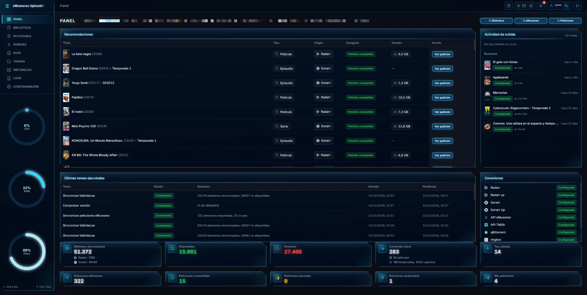
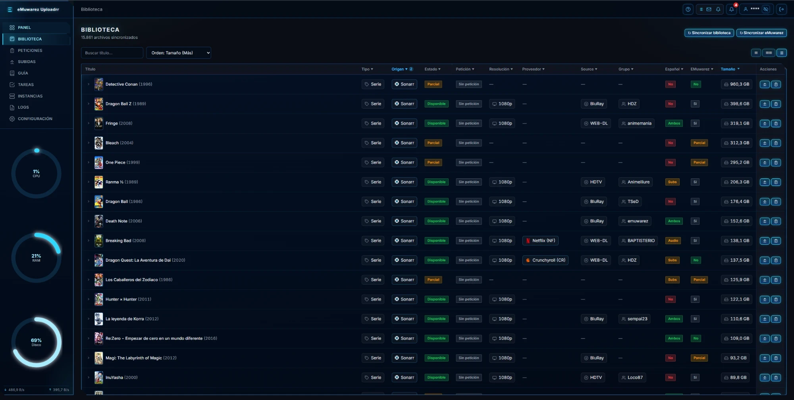
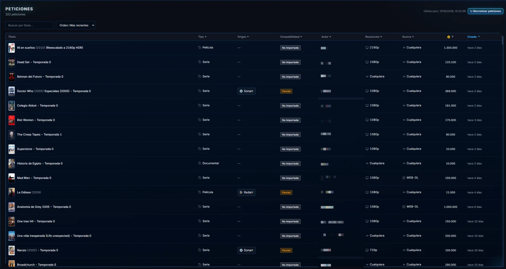
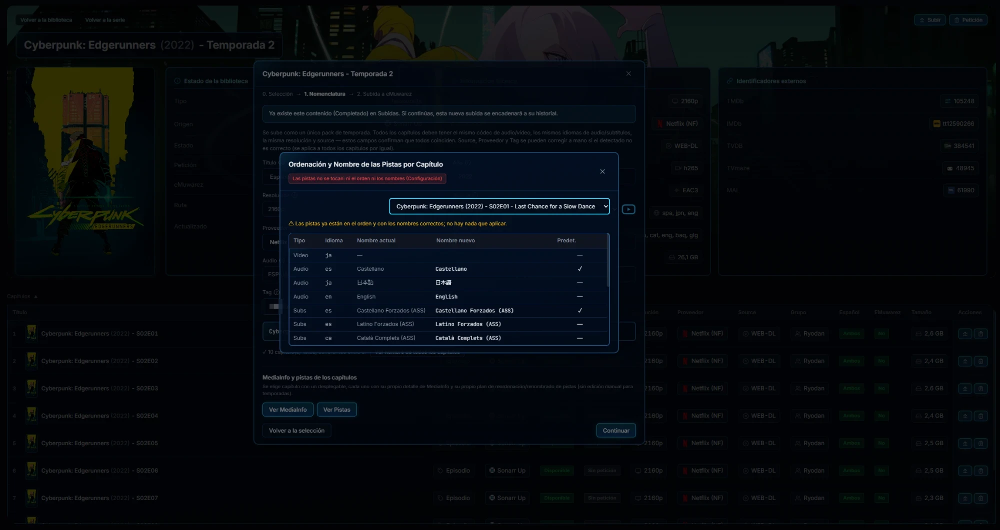
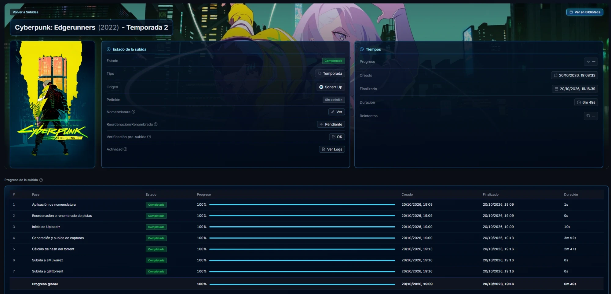
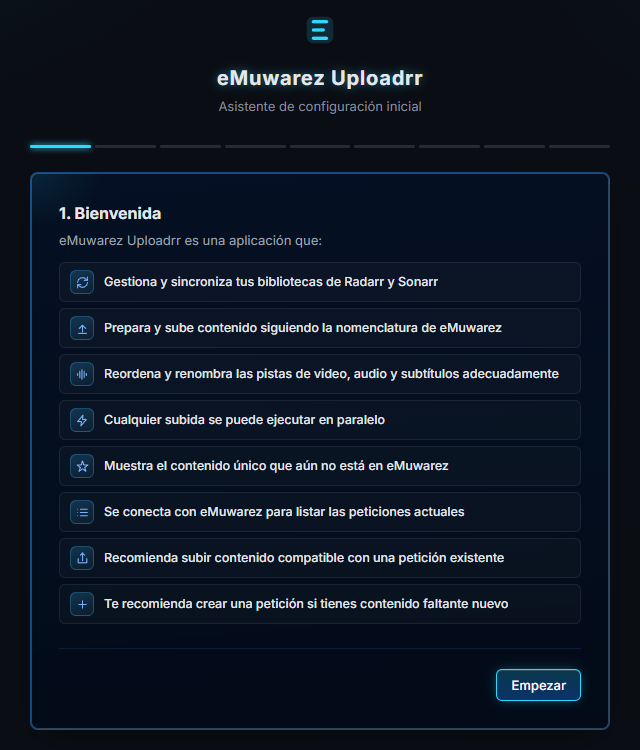
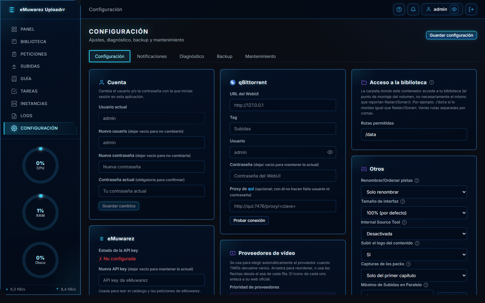

# eMuwarez Uploadrr

[](https://github.com/Kisnov/emuwarez-uploadrr/actions/workflows/ci.yml)
[](https://github.com/Kisnov/emuwarez-uploadrr/actions/workflows/publicar.yml)
[](https://github.com/Kisnov/emuwarez-uploadrr/actions/workflows/zizmor.yml)
[](https://coderabbit.ai)
[](.github/dependabot.yml)

Aplicación web autoalojada (+ CLI) para subir a **[eMuwarez](https://emu-warez.com)** (tracker UNIT3D) desde tu
biblioteca de **Radarr**/**Sonarr**. Sincroniza la biblioteca, la cruza con las peticiones abiertas de eMuwarez,
genera el nombre con la nomenclatura del tracker, enlaza los ficheros en una carpeta de subidas y lanza la subida
con [Uploadrr-EMU](https://github.com/Kisnov/Uploadrr-EMU), que va dentro de la imagen. Todo desde la interfaz web.

## Qué hace

- **Panel**: lo que puedes subir hoy. Arriba, tu perfil de eMuwarez (ratio, subido, bajado, buffer, BON…) y un solo
  «Sincronizar todo» (biblioteca, catálogo y peticiones, una tras otra). «Listo para subir» son las peticiones que ya
  puedes cubrir, por recompensa, con el grupo de release y los idiomas de cada copia; «Subir» abre el asistente sobre
  la petición. «En curso» enseña las subidas en marcha y las últimas terminadas. Una banda «Necesita atención» avisa
  de instancias caídas, subidas fallidas y versión nueva.
- **Biblioteca**: películas y series de Radarr/Sonarr con su estado (Disponible, Faltante, Subiendo, Subido, Error) y
  si llevan castellano (Ambos, Audio, Subs, No). Cada fila lleva bajo el título una línea con el tipo, la resolución,
  el source, el proveedor, el códec y los idiomas, y el **grupo de release** a la derecha. Los filtros están en la
  cabecera, con varias opciones a la vez, y una combinación de filtros y orden se guarda como **vista** para volver
  a ella con un clic. En la ficha de cada ítem: MediaInfo, pistas, temporadas y capítulos, el grupo de release y la
  petición que cubre.
- **Peticiones**: las peticiones abiertas de eMuwarez cruzadas con lo que ya tienes, agrupadas por lo que puedes
  hacer: «Lista para subir», «Parcial», «No la tienes» y «Cerradas» (reclamadas, llenas o ya subidas), con la mayor
  recompensa primero. La columna Autor está oculta salvo que la actives. Se sincronizan una vez al día, y «Rellenar
  petición» abre la petición con la URL del torrent ya copiada al acabar una subida.
- **Subidas**: un asistente con pasos (contenido, nombre y pistas, **resumen**) comprueba el contenido, genera el nombre
  (también para packs de temporada) y lanza Uploadrr-EMU. El resumen enseña lo que se sube (nombre, ficheros,
  categoría, petición, pistas y tipo de copia) y lo que ya hay en eMuwarez del mismo contenido, con si lo tuyo es
  mejor, igual o peor, antes de pulsar «Subir». Opcionalmente renombra y reordena las pistas (cuatro modos, apagado
  por defecto). El detalle de una subida terminada abre por el resultado (enlace a eMuwarez, estado de siembra en
  qBittorrent y dónde se fue el tiempo); si falla, se reintenta desde el paso que falló. Progreso en
  directo, límite de subidas en paralelo y varios grupos de subida guardados para el tag. «Seleccionar» en
  Biblioteca marca varias películas, series o temporadas y «Subir por lotes» las encola de una vez (una serie se
  abre en sus temporadas y solo entran como pack las que están listas; las demás se listan con su motivo), con su
  nombre, sus comprobaciones y lo que ya hay en eMuwarez de cada una; en el Panel, «Seleccionar» en «Listo para subir» hace lo mismo con las peticiones (cada subida, enlazada a su petición)
  y las otras ideas, y en Peticiones, con las peticiones que ya se pueden subir. Desde Biblioteca, cada subida se enlaza a
  la petición abierta que la cubre si hay una sola. En Subidas el lote se sigue, se cancela, se reintenta o se borra junto
  (las que siguen en cola o subiendo no se borran). En Ajustes → Notificaciones se elige si un lote avisa una vez por subida o una sola vez
  al terminar, con el resumen.
- **Estadísticas**: tu ratio, lo subido, lo bajado y el bonus en gráficos, día a día, junto a las cifras de la
  biblioteca y de las peticiones.
- **Guía**: cada campo de la nomenclatura de eMuwarez, con ejemplos y de dónde lo saca la aplicación.
- **Tareas**: sincronización periódica de biblioteca y peticiones, vigilancia de instancias (sincroniza una Radarr o
  Sonarr cuando vuelve a responder), mantenimiento nocturno con copias automáticas y aviso de versión nueva en la campana.
- **Instancias**: tus Radarr y Sonarr.
- **Logs**: registros de la aplicación y de cada subida, con los secretos redactados.
- **Configuración**: un índice de secciones con buscador y una barra de guardado que cuenta los campos cambiados.
  Claves de TMDb, eMuwarez y hosts de imágenes (se comprueban contra el proveedor), qBittorrent, mapeo de rutas,
  notificaciones (Discord, Telegram, webhook), un widget para [Homepage](https://gethomepage.dev) con su propia clave de
  solo lectura, diagnóstico, backup y mantenimiento.

Además: **Ctrl+K** (o Cmd+K) abre una paleta para saltar a una sección o a una película o serie, y en ventanas
estrechas el menú lateral es un cajón con botón de hamburguesa.

**Panel**



**Biblioteca**



**Peticiones**



**Asistente de subida**, con la revisión de las pistas de cada capítulo



**Detalle de una subida**, con el progreso de cada fase



## Arranque rápido (Docker Compose)

Requiere Docker 24+ con Compose v2. No hace falta clonar el repo: copia esto en un `docker-compose.yml`, ajusta
las rutas de los volúmenes y levántalo. Usa la imagen publicada en `ghcr.io/kisnov/emuwarez-uploadrr`, así que no
compila nada.

```yaml
services:
  emuwarez-uploadrr:
    image: ghcr.io/kisnov/emuwarez-uploadrr:${EMUWAREZ_UPLOADRR_TAG:-latest}
    container_name: emuwarez-uploadrr
    restart: unless-stopped
    # Un init como proceso 1: recoge los procesos que quedan sueltos al cancelar una subida (ffmpeg, mkbrr...).
    init: true

    ports:
      - "${EMUWAREZ_UPLOADRR_PORT:-9494}:9494"

    # Ajusta PUID/PGID al UID/GID del usuario propietario de los archivos de media
    user: "${PUID:-1000}:${PGID:-1000}"

    # Límite de recursos del contenedor. Ajusta a lo que tenga disponible tu
    # equipo: es lo que marca cuántas "Subidas en Paralelo" (Configuración)
    # se sostienen de verdad, porque cada subida activa puede llegar a saturar
    # un núcleo entero (hasheo del torrent) y usar ~0.8 GB de RAM
    # (capturas/remux/transferencia). Con estos 2 núcleos y 2 GB caben
    # teóricamente 2 subidas en paralelo reales. Si quieres más, sube los dos
    # valores a la vez: subir "Subidas en Paralelo" sin darle más CPU y RAM al
    # contenedor no acelera nada.
    cpus: "2"
    mem_limit: "2g"

    environment:
      TZ: ${TZ:-Europe/Madrid}
      CONFIG_DIR: /config
      # Carpeta donde se enlaza lo que se sube. Uploadrr-EMU se la da a
      # qBittorrent como ruta de guardado, así que tiene que estar en el mismo
      # sistema de ficheros que la media (para que sea un enlace duro) y
      # qBittorrent tiene que verla en esta misma ruta.
      UPLOADRR_UPLOADS_DIR: /data/uploads/emu

    volumes:
      # Configuración persistente: base de datos SQLite, settings, y el
      # config.yaml/temporales de Uploadrr-EMU (bajo /config/Uploadrr).
      - /srv/emuwarez-uploadrr/config:/config

      # Raíz de datos compartida: media de Radarr/Sonarr y carpeta de subidas.
      - /srv/data:/data
```

Opcionalmente, crea al lado un `.env` para no editar el compose:

```env
PUID=1000
PGID=1000
TZ=Europe/Madrid
EMUWAREZ_UPLOADRR_PORT=9494
```

Y levanta el contenedor:

```bash
docker compose up -d
```

Abre `http://localhost:9494`: el asistente de configuración inicial se abre solo.

<p align="center"></p>

> Las API keys (TMDb, eMuwarez, Radarr/Sonarr…) se configuran desde el asistente web o desde Configuración, nunca
> en el compose ni en el `.env`.

### Rutas: lo único delicado

- **La carpeta de subidas** (`UPLOADRR_UPLOADS_DIR`) tiene que estar en el mismo sistema de ficheros que la media.
  Cuando no se puede crear un enlace duro (otro sistema de ficheros, un montaje CIFS o NFS que no los admite, o el
  límite de enlaces del fichero), la aplicación crea uno simbólico, y solo se siembra si qBittorrent puede resolver
  a dónde apunta. Sin la variable, la carpeta es `/config/Uploadrr/uploads`, normalmente en otro disco.
- **Créala antes de arrancar**, con el mismo dueño que `PUID:PGID`: si `/srv/data` es de root, el contenedor no
  puede crearla y las subidas se quedan sin preparar.

  ```bash
  mkdir -p /srv/data/uploads/emu
  chown 1000:1000 /srv/data/uploads/emu   # tu PUID:PGID
  ```
- **qBittorrent** tiene que ver la carpeta de subidas en la misma ruta que este contenedor.
- **Si Radarr/Sonarr ven la media en otra ruta** que este contenedor, añade una regla en Configuración →
  Diagnóstico → *Mapeo de rutas (biblioteca remota)*.
- **Rutas permitidas** (Configuración → *Acceso a la biblioteca*) es `/data` por defecto. Si montas la raíz de
  datos en otra ruta, ponla ahí.



### Versiones y volver atrás

La imagen se publica con varias etiquetas, y `EMUWAREZ_UPLOADRR_TAG` (en el `.env`) elige cuál usa el compose:

- `latest` (sin la variable): la última versión publicada. La publica el workflow *Publicar versión*, a mano
  o solo los días impares del mes si hay cambios suficientes, siempre después de pasar los tests (con la entrada `ref`
  publica la versión de un commit anterior); o `scripts/desplegar.sh` desde tu equipo. Se actualiza con `docker compose pull && docker compose up -d`.
- `0.16.2`: una versión concreta, de las que tienen etiqueta `v0.16.2` en el repo. Sirve para quedarte en ella o
  para volver atrás si la nueva falla.
- El sha del commit de una versión: cada versión publicada tiene también esa etiqueta.
- `edge`: lo más nuevo. Una prueba sin publicar como versión (la punta de `master` con el workflow en *solo
  prueba*, o tu commit con `scripts/desplegar.sh --solo-prueba`), y también cada versión publicada, así que nunca
  se queda por detrás de `latest`.

```bash
EMUWAREZ_UPLOADRR_TAG=0.16.2 docker compose up -d
```

Si la versión nueva cambió el esquema de la base, la versión vieja no arranca y lo dice en el registro: la base ya
no es la suya. Antes de migrar, la app deja una copia en `/config/backups/pre-migracion-*.db` (las tres últimas).
Para volver atrás, para el contenedor, copia esa copia sobre `/config/emuwarez_uploadrr.db`, borra los
`emuwarez_uploadrr.db-wal` y `-shm` que haya al lado y arranca la versión vieja; lo que se hizo desde la
actualización se pierde.

### Construir la imagen tú mismo

```bash
git clone https://github.com/Kisnov/emuwarez-uploadrr.git
cd emuwarez-uploadrr
cp .env.example .env
docker compose -f docker-compose.example.yml build \
  --build-arg UPLOADRR_COMMIT=$(git ls-remote https://github.com/Kisnov/Uploadrr-EMU.git main | cut -f1)
docker compose -f docker-compose.example.yml up -d
```

> Uploadrr-EMU va empaquetado dentro de la imagen: no hay que montar ni configurar nada aparte para él. Su
> `config.yaml` y sus temporales persisten bajo el volumen `/config`.

Sin minutos de CI, o para probar un commit, construye la imagen en tu equipo, guárdala y cárgala en el servidor, sin
pasar por el registro:

```bash
git -c core.autocrlf=false archive HEAD | docker build -t ghcr.io/kisnov/emuwarez-uploadrr:edge   --build-arg UPLOADRR_COMMIT=$(git ls-remote https://github.com/Kisnov/Uploadrr-EMU.git main | cut -f1)   --build-arg APP_COMMIT=$(git rev-parse HEAD) -
docker save ghcr.io/kisnov/emuwarez-uploadrr:edge | gzip > emuwarez-edge.tar.gz
# En el servidor: carga la imagen y recrea el contenedor sin descargar nada
docker load -i emuwarez-edge.tar.gz && docker compose up -d --pull never
```

## Uso sin Docker

Necesita Python 3.12+, Node 26, `mediainfo`, `ffmpeg`, `mkvtoolnix` y una copia de Uploadrr-EMU (ruta en el ajuste
`uploadrr.path`, por defecto `/opt/Uploadrr`).

```bash
pip install -e ".[web]"
(cd frontend && npm ci && npm run build)
python3 emuwarez_uploader.py web serve --host 0.0.0.0 --port 9494
```

La CLI también tiene un comando para cada acción de la web (sincronizar, listar biblioteca y peticiones, generar
la nomenclatura, subir…): ver [`README_CLI_READY.md`](README_CLI_READY.md).

## Desarrollo

```bash
# Backend, en Linux (hardlinks, mediainfo, mkvtoolnix): ~4000 tests, ~11 min
pip install -e ".[web,dev]"
python -m pytest tests -q -p no:cacheprovider

# Frontend
cd frontend && npm ci && npx tsc --noEmit && npx vitest run && npx vite build
```

En cada PR, el CI pasa las reglas graves de `ruff`, los tests del backend con una cobertura mínima del 78 % y `tsc`,
`vitest` y `vite build` del frontend. Un PR que solo toca `frontend/`, `docs/` o ficheros `.md` limita los
tests del backend a los que mencionan el frontend, sin mínimo de cobertura. Si toca `.github/`, [zizmor](https://docs.zizmor.sh) revisa los
workflows y `dependabot.yml`.

Dependabot propone cada semana las versiones nuevas de pip, npm, la imagen base del `Dockerfile` y las GitHub
Actions, cuando llevan 7 días publicadas: las menores y los parches juntos en un PR por ecosistema, y cada versión
mayor en el suyo. Las de seguridad no esperan esos 7 días: llegan en cuanto un aviso tiene versión corregida.

`CLAUDE.md` recoge las reglas de arquitectura y el
contrato con Uploadrr-EMU (argumentos, claves de `config.yaml` y líneas de salida que se leen): si cambias uno de
los dos lados, cambia el otro a la vez.

## Documentación

- [`docs/DEPLOYMENT_DOCKER.md`](docs/DEPLOYMENT_DOCKER.md): despliegue Docker paso a paso y troubleshooting.
- [`docs/source_engine.md`](docs/source_engine.md): motor de detección de source y nomenclatura.
- [`README_CLI_READY.md`](README_CLI_READY.md): referencia de la CLI, generada con `scripts/referencia_cli.py`.

## Stack

- Backend: Python (FastAPI) + SQLite.
- Frontend: React + Vite + TypeScript, servido como estáticos por el backend.
- Integraciones: Radarr, Sonarr, TMDb, eMuwarez (UNIT3D), Uploadrr-EMU, qBittorrent.

## Licencia

Uso privado/homelab. No redistribuido públicamente.
